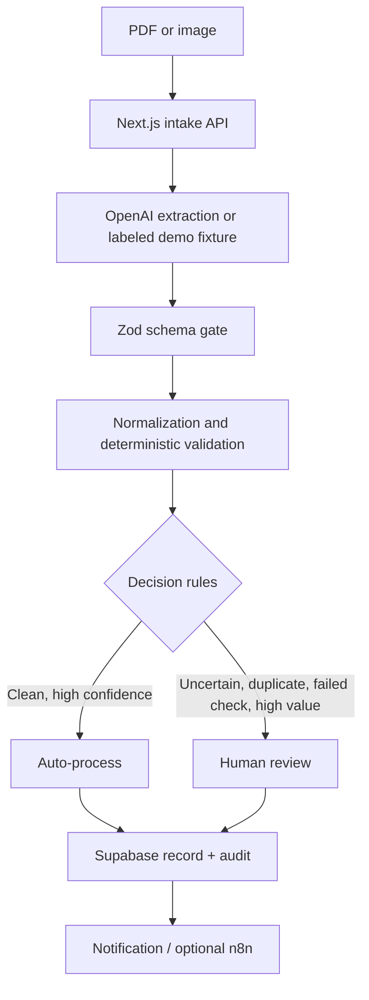

# LedgerLens AI

**Turn invoices into verified data.** A portfolio-grade human-in-the-loop invoice automation workspace for a fictional SMB.

## Business problem and impact

Invoice operators repeatedly transcribe fields, verify totals, check duplicates and purchase orders, and escalate exceptions. LedgerLens demonstrates a safer flow: automate repetitive extraction and deterministic checks, route uncertainty to a human, and preserve a trace of the decision. This is a workflow demonstration, not a measured customer ROI claim.

## Architecture



AI suggests structured invoice fields; it does not approve invoices. Deterministic rules own arithmetic, date, duplicate, PO, risk, and routing decisions. See [Architecture](docs/ARCHITECTURE.md), [Automation](docs/AUTOMATION.md), and [Business rules](docs/BUSINESS_RULES.md).

## Included experience

Dashboard, searchable document workspace, detail and run timelines, review queue with approve/reject/reprocess actions, vendor analytics, integration status, upload form, health endpoint, Supabase migration, and importable n8n example. Six fictional invoices cover a clean case, moderate confidence, duplicate, arithmetic mismatch, invalid PO, and high-value invoice. Dashboard metrics are explicitly sample data.

## Demo and live modes

Demo mode requires no paid integration and uses stable fixture data. It does not represent fixture extraction as live AI. Demo Mode is the default unless `DEMO_MODE=false` is set. The upload API requires Supabase because uploaded documents must be securely persisted; without it, inspect the included sample invoices.

Live document intake requires Supabase and OpenAI. Files are stored in the private bucket, then the server worker extracts structured candidates through OpenAI's Responses API, validates them with Zod and deterministic business rules, persists outcomes, and routes exceptions to human review. The worker logs a notification and sends email when Resend and a review recipient are configured. See the [Responses API documentation](https://platform.openai.com/docs/api-reference/responses) for PDF and image input formats. Secrets are read only by server code. Set environment values in `.env.local` using [.env.example](.env.example). Never use a service role key in a `NEXT_PUBLIC_` variable.

| Variable | Purpose |
|---|---|
| `DEMO_MODE` | `true` to display deterministic fixture mode |
| `NEXT_PUBLIC_SUPABASE_URL` | Supabase project URL |
| `SUPABASE_SERVICE_ROLE_KEY` | Server-only database and storage access |
| `OPENAI_API_KEY`, `OPENAI_MODEL` | Optional live extraction |
| `WEBHOOK_SECRET` | Optional bearer token for ingestion endpoint |
| `RESEND_API_KEY`, `EMAIL_FROM` | Optional email adapter configuration |
| `REVIEW_EMAIL_TO` | Optional review notification recipient |
| `N8N_WEBHOOK_URL`, `N8N_WEBHOOK_SECRET` | Optional workflow endpoint configuration |

## Local setup

```bash
npm install
Copy-Item .env.example .env.local
npm run dev
```

Open http://localhost:3000. Demo Mode runs without external services. To exercise Live Mode, you can use the existing Northstar Supabase project: set the same project URL and server-only service role key in this app’s `.env.local`, set `DEMO_MODE=false`, and configure `OPENAI_API_KEY`. Apply `supabase/migrations/001_ledgerlens_init.sql` in that project after the Northstar migration. Every LedgerLens table, index, and the private Storage bucket is prefixed/named `ledgerlens_` / `ledgerlens-invoice-documents`, so it does not overwrite Northstar’s `app_settings`, `automation_runs`, or other objects. The migration adds only LedgerLens-owned schema objects and sample purchase orders. Keep the service role key out of browser code and source control.

## API and workflow

- `POST /api/documents/upload` — multipart `file`, limited to PDF/JPEG/PNG and 10 MB; checks file signatures, stores privately, and runs extraction/validation synchronously in Live Mode. Demo Mode stores uploads as queued without spending on AI.
- `POST /api/webhook/document` — accepts a base64 document, checks type/size, stores privately, and runs the same worker in Live Mode; optionally enforces `Authorization: Bearer <WEBHOOK_SECRET>`.
- `POST /api/documents/{id}/approve`, `/reject`, `/reprocess` — server-side human actions (require persisted Supabase data).
- `GET /api/health` — application mode and database availability, with no secrets.

Import `n8n/ledgerlens-document-workflow.json` in n8n. It validates intake metadata, hands documents to the worker endpoint, routes the resulting decision, and supports notification branches. Set the n8n environment URLs and secrets before activating the workflow.

## Data and security

The migration defines the namespaced `ledgerlens_*` documents, invoices, line items, vendors, purchase orders, validation results, automation runs, review queue, audit logs, notifications, and app settings tables. Validate payloads before database operations, limit uploads, sanitize names, keep storage private, and use service credentials only server-side. Before production, add authenticated sessions, tenant isolation policies, a durable background queue for long-running workloads, rate limiting, key rotation, and retention controls. Never upload real financial documents to the public demo.

## Verification and portfolio talking points

```bash
npm run lint
npm run test
npm run build
```

Tests cover arithmetic, dates, duplicate detection, confidence, decision rules, strict extraction schema, file signatures, the OpenAI request adapter, and an end-to-end mocked worker lifecycle. The worker test verifies invoice/line-item/validation/run/audit/notification persistence, duplicate-to-review routing, malformed-output exceptions, provider failures, and retry idempotency against an in-memory Supabase-compatible test double. A real Supabase/OpenAI/Resend smoke test still requires your service credentials.

## Next steps

Seed the Supabase project with the six sample records, add authenticated multi-tenant access and durable asynchronous job processing, and integrate an accounting export adapter behind human-approved records.
