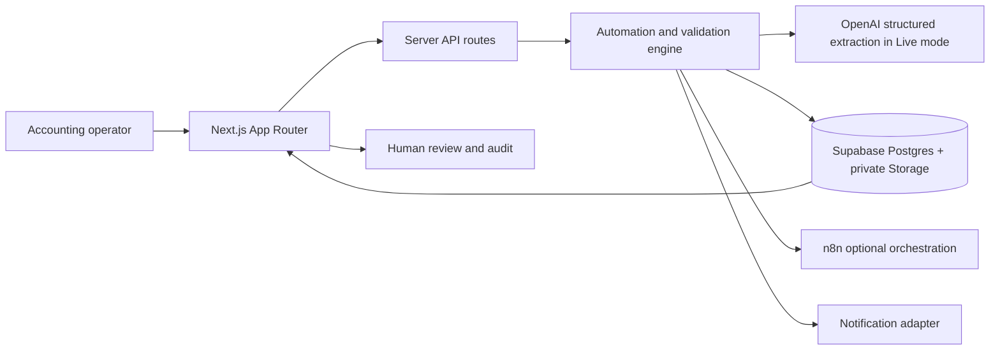

# Architecture

The React server-rendered workspace observes documents, queues, vendors, and runs. API routes validate untrusted uploads and review input; service credentials remain server-only. The extraction layer produces candidate fields only. Zod validates the shape, then deterministic validators check required fields, math, dates, duplicates, PO references, value, and confidence. A decision engine routes clean low-risk invoices or creates a human exception.

Supabase is the system of record: private document objects, invoices, line items, validation outcomes, automation runs, review items, notifications, settings, and immutable-style audit events. RLS blocks browser roles; server routes use service-role access after validation. OpenAI is optional and used only in live mode. n8n is optional orchestration around the app's ingestion/processing APIs, not a second implementation of financial policy. Email is optional; demo mode logs mock notifications.

The included UI ships with fictional deterministic fixtures for a useful no-credential preview. In Live Mode, uploads run synchronously through the worker, while Supabase persists outcomes and the workspace reads those records back. The route has a 120-second platform duration cap; a production deployment should move extraction to a durable background queue, and add authenticated user sessions and tenant-scoped RLS policies before exposing financial records to multiple customers.
